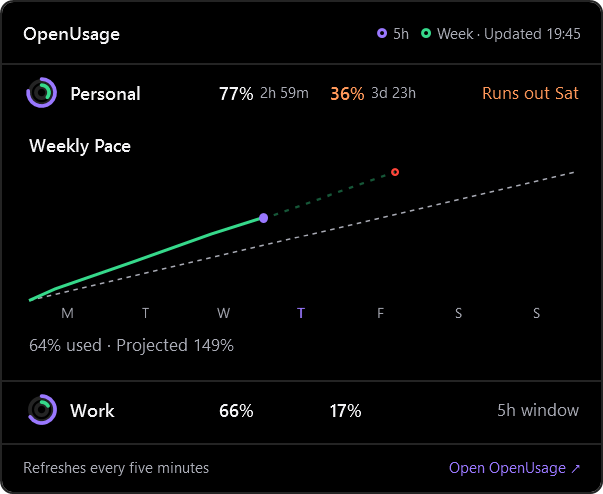

<div align="center">

# OpenUsage

### Your AI limits. One quiet place.

Session limits, weekly usage and reset times — in your tray, on your desktop, or one hover away.

[Windows](#openusage-for-windows) · [macOS](#get-started) · [Documentation](docs/README.md) · [MIT License](LICENSE)

</div>

<p align="center">
  <a href="docs/images/windows/overview-dark.png"></a>
  &nbsp;&nbsp;
  <a href="docs/images/windows/mini-widget-chart.png"></a>
</p>

<p align="center"><sub>Real renders of the current Windows interface. All accounts and usage values shown are demonstration data.</sub></p>

This fork adds a native Windows edition to [Robin Ebers' OpenUsage](https://github.com/robinebers/openusage).
Windows and macOS have separate builds and releases.

> **New Windows interface:** the screenshots and features below reflect the current `main` branch.
> The published **v0.1.1 executable is an earlier build**. To use the new interface now,
> [build from source](#windows) or download the artifact from a successful [Windows CI run](https://github.com/playertwo1/openusage/actions/workflows/windows.yml).

## Get Started

| | Windows | macOS |
|---|---|---|
| **Download** | [Portable x64 · v0.1.1](https://github.com/playertwo1/openusage/releases/download/windows-v0.1.1/OpenUsage-windows-x64.exe) | [Universal DMG](https://github.com/robinebers/openusage/releases/latest) |
| **Requirements** | Windows 10 or 11 | macOS 15 Sequoia or later; Apple Silicon or Intel |
| **Install** | Download and run. No installer or separate .NET installation needed. | Open the DMG and drag OpenUsage to Applications. |
| **Updates** | Download a newer Windows release manually. | Signed, notarized in-app Sparkle updates. |
| **Guide** | [Windows documentation](docs/windows.md) | [macOS documentation](docs/README.md) |

On macOS, you can also install with Homebrew:

```sh
brew install --cask openusage
```

Choose **Add Account** on Windows or **Accounts → +** on macOS to sign in.
Multiple accounts from the same provider are supported.

## OpenUsage for Windows

A compact native desktop app with three ways to stay informed:

| View | When to use it |
|---|---|
| **Main panel** | Read account limits and reset times, switch between used and remaining, and expand weekly charts. |
| **Mini widget** | Keep just provider names, two bars and percentages on the desktop. Purple is 5h; green is weekly. |
| **Corner ball** | Keep the desktop clear. Hover for the account panel; click an account to open its chart in place. |

### A Clearer View of Your Accounts

- **Room for every account.** Names sit above the metrics, in your saved order.
- **Height that follows the content.** The panel grows and shrinks with visible accounts and expanded charts. Scrolling is needed only when content exceeds the monitor's work area.
- **Weekly pace at a click.** Compare observed usage with an even pace and see the projection for the current week.
- **Used or remaining.** Change the value convention and filter to starred metrics.
- **Your preferred display.** Choose light, AMOLED dark or system appearance, text size, reset format and account-label privacy. Optional soft transparency can be disabled for a solid background.

<p align="center">
  <a href="docs/images/windows/overview.png"></a>
</p>

Pace projections use provider-reported percentages and reset times. Missing observations stay missing.
They are usage projections, not dollar or token estimates.

### From a Ball to a Weekly Chart

**Hover → choose an account → see its chart.** The panel stays open while your pointer is over it.
Click the same account again to close its chart, or another account to switch.

<p align="center">
  
  &nbsp;&nbsp;&nbsp;
  
</p>

<p align="center">
  <a href="docs/images/windows/mini-widget-flyout.png"></a>
</p>

- **Click the ball** to expand the compact mini. Use **−** to collapse it again.
- **Drag either view** near the top, bottom, sides or corners to snap it into place. Position and collapsed state are saved.
- **Right-click** for always-on-top, lock position, orientation and other widget actions.
- **Enable the widget** in **Settings → General** or from the tray menu.

Use **Ctrl+Alt+U** to open or hide the main panel. Closing it keeps OpenUsage in the tray;
choose **Exit** from the tray menu to quit.

<details>
<summary><strong>Accounts, Settings and Sign-In</strong></summary>

<p align="center">
  
  &nbsp;
  
</p>

**Accounts** lets you rename, remove and reorder accounts and providers, star up to two metrics per
account, and choose which metrics appear. Every metric starts shown; initial favorites match the
Mac edition. Hiding account names also applies to the tray and notifications, while Accounts keeps
them visible for management.

<p align="center">
  
</p>

Sign-in happens through your browser, a device code, or an API key, depending on the provider.
Tokens renew automatically when due. Provider-specific failures appear with the affected account.

</details>

**Current Windows limits:** no installer, automatic updater, Acrylic/Mica material, screenshot
sharing, macOS CLI export, or action to spend a limit reset. Shortcuts are fixed.
[Windows documentation](docs/windows.md) covers storage, refresh behavior and troubleshooting.

## Supported Providers

| Sign-In | Providers |
|---|---|
| **Browser or device code** | Claude · ChatGPT / Codex · Cursor · Antigravity · GitHub Copilot · Grok |
| **API key** | Ollama · OpenCode · OpenRouter · Z.ai |

OpenRouter's balance requires a **Management key**. Available metrics depend on what the provider
reports for your plan. [Provider details](docs/providers.md).

## Your Accounts, Your Credentials

You add every account explicitly inside OpenUsage. The app does not discover accounts or read
credentials, auth files, logs, databases or environment variables belonging to other tools.

| Platform | Credential Storage |
|---|---|
| **Windows** | Windows DPAPI encryption for your user account; stored with app preferences in `%LOCALAPPDATA%\OpenUsage.Windows\accounts.dat`. |
| **macOS** | The app's own Keychain service; account metadata lives in its preferences. |

Provider API requests are required to fetch usage. Tokens and provider response bodies are never
logged. The Windows implementation sends no telemetry; macOS telemetry is described in the
[privacy documentation](docs/privacy.md).

## Build from Source

### Windows

Install the [.NET 10 SDK](https://dotnet.microsoft.com/download/dotnet/10.0), then run PowerShell from the repository:

```powershell
./script/windows.ps1 run       # Build and launch
./script/windows.ps1 test      # Storage, OAuth, mapping and UI regression checks
./script/windows.ps1 publish   # Create a self-contained portable executable
```

The executable is written to `dist/windows/win-x64/OpenUsage.exe`.
The [Windows CI workflow](.github/workflows/windows.yml) builds, tests and uploads an x64 artifact.

### macOS

```sh
swift build
script/test_quiet.sh
./script/build_and_run.sh
```

Use `script/test_quiet.sh` on a Mac someone is using: UI tests host real windows. The development
bundle uses `com.robinebers.openusage.dev`, separate from the installed app.

## Documentation and Contributing

- [Windows guide](docs/windows.md) · [Visual product tour](docs/windows-tour.md) · [Windows changelog](Windows/CHANGELOG.md)
- [macOS behavior guides](docs/README.md) · [Architecture](docs/architecture.md) · [Adding a provider](docs/adding-a-provider.md)
- [macOS release setup](docs/macos-release-setup.md) · [Engineering conventions](AGENTS.md)
- [Contributing](CONTRIBUTING.md) · [Security reporting](SECURITY.md)

The macOS application was created by [Robin Ebers](https://github.com/robinebers/openusage).
This fork adds the Windows edition. Both remain open source under the [MIT License](LICENSE).
The OpenUsage name and logo are covered by the [trademark policy](TRADEMARK.md).

<sub>All screenshots above show the actual application with demo accounts.
[Screenshot source and regeneration](docs/images/windows/README.md).</sub>
