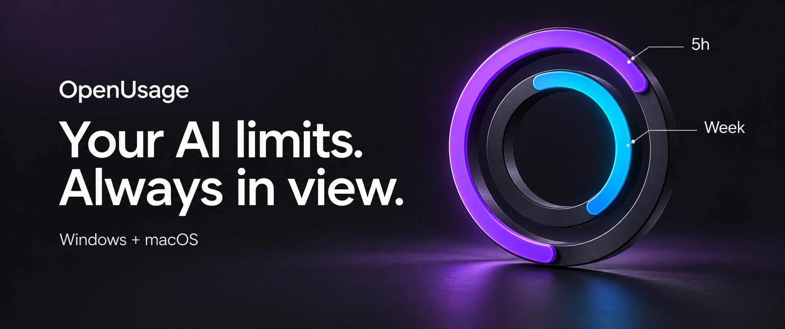
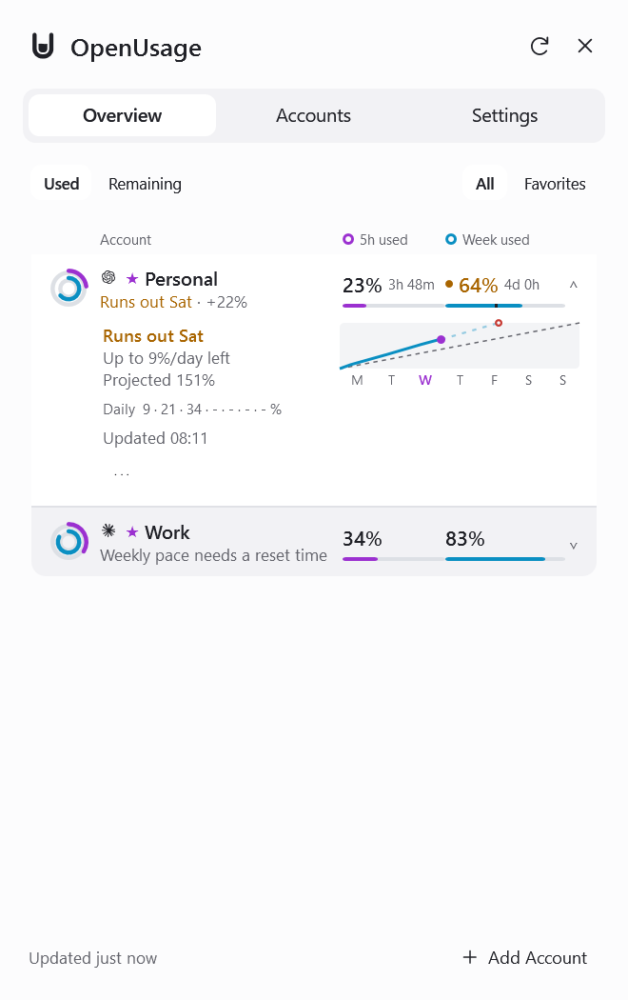
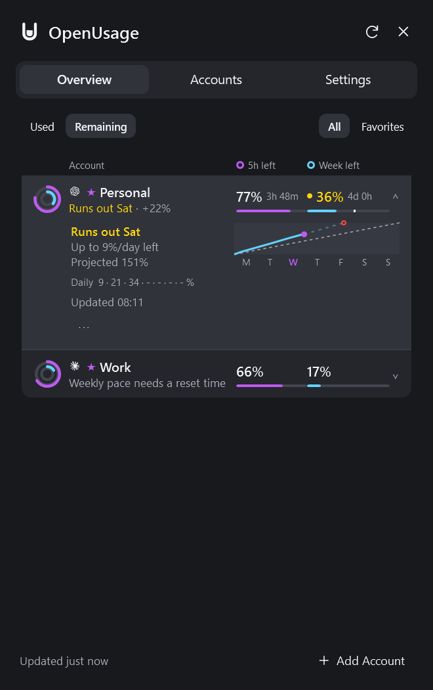
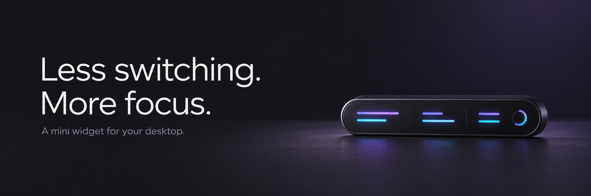
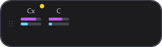
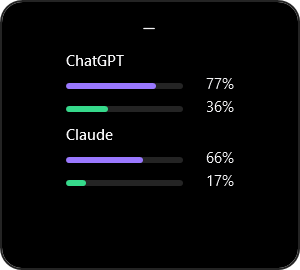
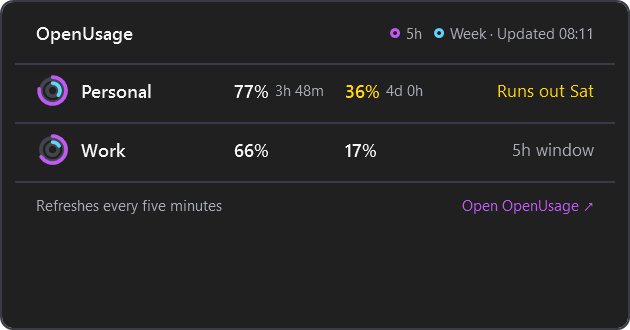
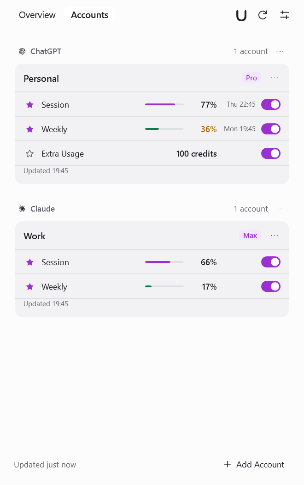
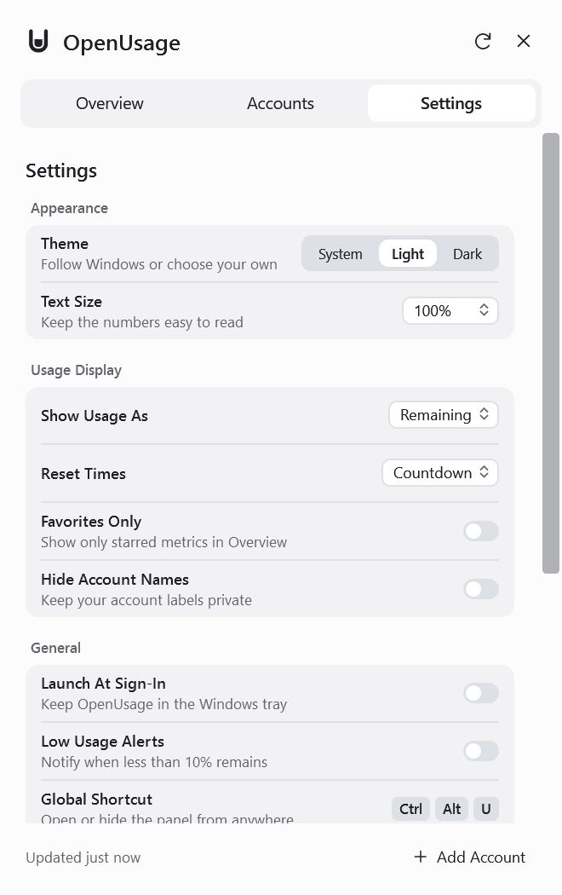
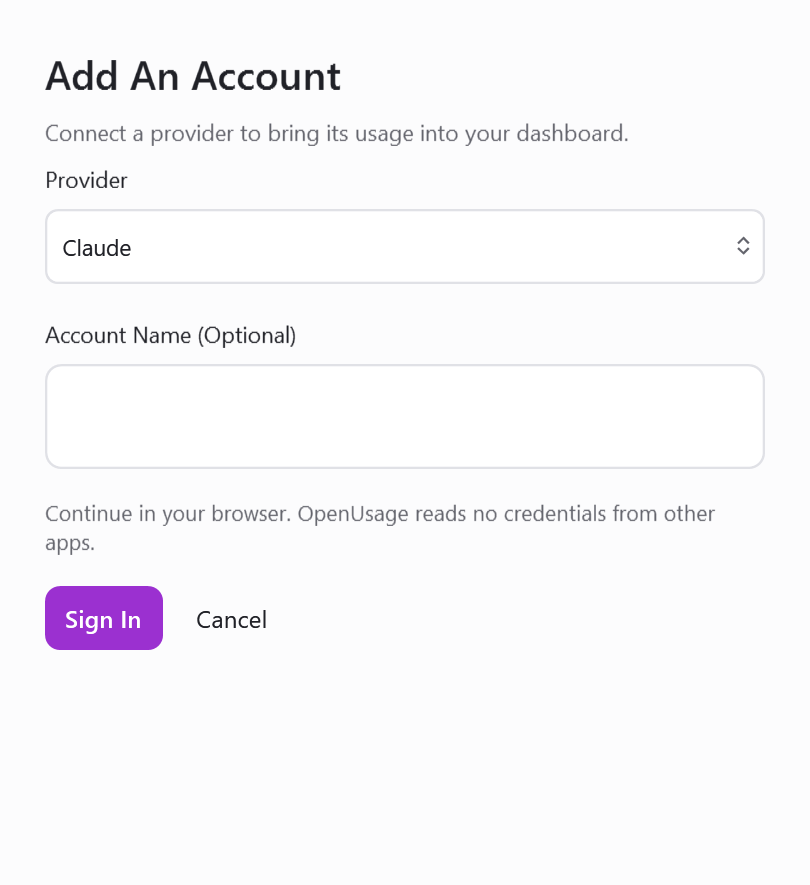

# OpenUsage

**Your AI subscription limits, in one place.**

Track usage, remaining limits and reset times across your AI coding accounts. Keep the numbers
close in the Windows tray or the macOS menu bar, without opening a dashboard for every provider.

<p align="center">
  
</p>

<p align="center">
  <a href="https://github.com/playertwo1/openusage/releases/download/windows-v0.1.1/OpenUsage-windows-x64.exe"><strong>Download for Windows</strong></a>
  &nbsp; · &nbsp;
  <a href="https://github.com/robinebers/openusage/releases/latest"><strong>Download for macOS</strong></a>
  &nbsp; · &nbsp;
  <a href="docs/README.md">Documentation</a>
</p>

This fork adds a native Windows edition to [Robin Ebers' OpenUsage](https://github.com/robinebers/openusage).
The two editions have separate builds and releases; their platform-specific features are listed below.

## Get Started

| | Windows | macOS |
|---|---|---|
| **Download** | [Portable x64 executable](https://github.com/playertwo1/openusage/releases/download/windows-v0.1.1/OpenUsage-windows-x64.exe) | [Universal DMG](https://github.com/robinebers/openusage/releases/latest) |
| **Requirements** | Windows 10 or 11 | macOS 15 Sequoia or later; Apple Silicon or Intel |
| **Install** | Download and run. No installer or separate .NET installation needed. | Open the DMG and drag OpenUsage to Applications. |
| **Updates** | Download a newer Windows release manually. | Signed, notarized in-app Sparkle updates. |
| **More** | [Windows guide](docs/windows.md) · [Release notes](Windows/CHANGELOG.md) | [macOS documentation](docs/README.md) · [Release notes](CHANGELOG.md) |

macOS users can also install with Homebrew:

```sh
brew install --cask openusage
```

Open the app, choose **Add Account** on Windows or **Accounts → +** on macOS, and sign in to a provider.
You can add multiple accounts for the same provider.

## OpenUsage for Windows

A compact WPF desktop app with a tray icon, light and dark themes, and a view of both your session
and weekly limits. Violet identifies the **5h session** window; cyan identifies the **weekly** window.

<p align="center">
  <a href="docs/images/windows/overview.png"></a>
  &nbsp;
  <a href="docs/images/windows/overview-dark.png"></a>
</p>

### Know What Is Left

- **One view for your accounts.** Session and weekly values, reset times and provider identities stay together in your saved order.
- **Used or remaining.** Switch the values, rings and bars with one control. Filter to your favorites when you want less to scan.
- **Weekly pace.** Expand an account to compare observed usage with an even pace, see a projection and check the daily history the app has recorded.
- **Your preferred view.** Choose a system, light or dark theme, larger text, exact reset dates or countdowns, and account-name privacy.
- **Useful alerts.** Optional notifications when a limit crosses 90% used, plus favorites in the tray menu.

Pace projections use the provider's weekly percentage and reset time. Daily history reflects readings
the app actually observed; missing days stay missing. These are usage projections, not dollar or
token estimates. [See the Windows product tour](docs/windows-tour.md) for the full behavior.

### Stay in Flow

<p align="center">
  
</p>

The optional **mini widget** keeps a small view of your accounts on the desktop. Drag it to a screen
edge, choose horizontal or vertical layout, and hover or click for the account flyout. Its position
is remembered per monitor.

<p align="center">
  
  &nbsp;&nbsp;
  
</p>

<p align="center">
  
</p>

Enable it in **Settings → General**, from the tray menu.
Use **Ctrl+Alt+U** to open or hide the main panel. Closing the panel keeps the tray app running;
choose **Exit** from the tray menu to quit.

<details>
<summary><strong>Accounts, Settings and Sign-In</strong></summary>

<p align="center">
  
  &nbsp;
  
</p>

**Accounts** lets you rename, remove and reorder accounts and providers, star up to two metrics per
account, and choose which metrics appear. Every metric starts shown; initial favorites match the
Mac edition. Hiding account names also applies to the tray and notifications, while Accounts keeps
them visible for management.

<p align="center">
  
</p>

Sign-in happens through your browser, a device code, or an API key, depending on the provider.
Tokens renew automatically when due. Provider-specific failures appear with the affected account.

</details>

**Current Windows limits:** no installer, automatic updater, Acrylic/Mica material, screenshot
sharing, macOS CLI export, or action to spend a limit reset. Shortcuts are fixed.
[Windows documentation](docs/windows.md) covers storage, refresh behavior and troubleshooting.

## Supported Providers

| Sign-In | Providers |
|---|---|
| **Browser or device code** | Claude · ChatGPT / Codex · Cursor · Antigravity · GitHub Copilot · Grok |
| **API key** | Ollama · OpenCode · OpenRouter · Z.ai |

OpenRouter's balance requires a **Management key**. Available metrics depend on what the provider
reports for your plan. [Provider details](docs/providers.md).

## Your Accounts, Your Credentials

You add every account explicitly inside OpenUsage. The app does not discover accounts or read
credentials, auth files, logs, databases or environment variables belonging to other tools.

| Platform | Credential Storage |
|---|---|
| **Windows** | Windows DPAPI encryption for your user account; stored with app preferences in `%LOCALAPPDATA%\OpenUsage.Windows\accounts.dat`. |
| **macOS** | The app's own Keychain service; account metadata lives in its preferences. |

Provider API requests are required to fetch usage. Tokens and provider response bodies are never
logged. The Windows implementation sends no telemetry; macOS telemetry is described in the
[privacy documentation](docs/privacy.md).

## Build from Source

### Windows

Install the [.NET 10 SDK](https://dotnet.microsoft.com/download/dotnet/10.0), then run PowerShell from the repository:

```powershell
./script/windows.ps1 run       # Build and launch
./script/windows.ps1 test      # Storage, OAuth, mapping and UI regression checks
./script/windows.ps1 publish   # Create a self-contained portable executable
```

The executable is written to `dist/windows/win-x64/OpenUsage.exe`.
The [Windows CI workflow](.github/workflows/windows.yml) builds, tests and uploads an x64 artifact.

### macOS

```sh
swift build
script/test_quiet.sh
./script/build_and_run.sh
```

Use `script/test_quiet.sh` on a Mac someone is using: UI tests host real windows. The development
bundle uses `com.robinebers.openusage.dev`, separate from the installed app.

## Documentation and Contributing

- [Windows guide](docs/windows.md) · [Visual product tour](docs/windows-tour.md) · [Windows changelog](Windows/CHANGELOG.md)
- [macOS behavior guides](docs/README.md) · [Architecture](docs/architecture.md) · [Adding a provider](docs/adding-a-provider.md)
- [macOS release setup](docs/macos-release-setup.md) · [Engineering conventions](AGENTS.md)
- [Contributing](CONTRIBUTING.md) · [Security reporting](SECURITY.md)

The macOS application was created by [Robin Ebers](https://github.com/robinebers/openusage).
This fork adds the Windows edition. Both remain open source under the [MIT License](LICENSE).
The OpenUsage name and logo are covered by the [trademark policy](TRADEMARK.md).

<sub>Product screenshots use demo accounts. The cover and widget banners are AI-generated conceptual
illustrations, not application screenshots. [Artwork provenance and prompts](assets/readme/PROVENANCE.md).</sub>
