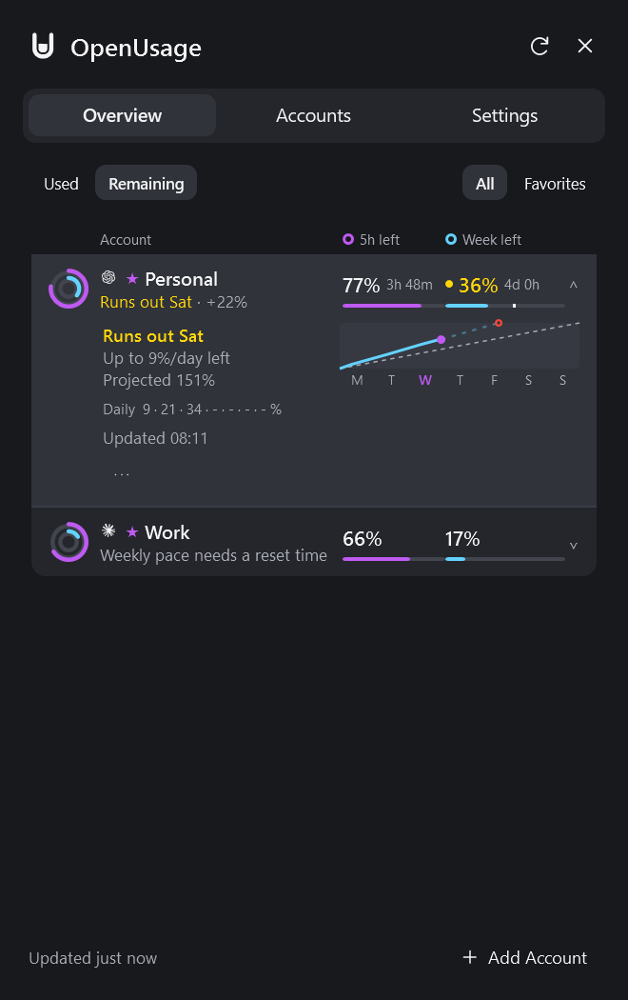
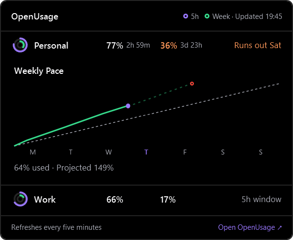

# OpenUsage for Windows

Native Windows edition of OpenUsage: a tray app that shows the 5h and weekly limits of your AI coding
accounts (Claude, Codex, Cursor, Copilot, Antigravity, Grok, Ollama, OpenCode, OpenRouter, Z.ai).

<p align="center">
  <a href="../docs/images/windows/overview-dark.png"></a>
  &nbsp;&nbsp;
  <a href="../docs/images/windows/mini-widget-chart.png"></a>
</p>

<p align="center"><sub>Demonstration data only.</sub></p>

## Features

- **Main panel, mini widget and provider icon notch** for reading limits and reset times at a glance.
- **Weekly pace:** compares usage with an even pace and projects whether the week will last.
- **Low usage alerts:** a tray notification each time the 5h or weekly window falls to 50%, 40%, 30%,
  20% and 10% remaining. The weekly alert says whether you are on pace to last the week. Toggle it in
  Settings → General → Low Usage Alerts.
- **Multiple accounts** per provider, in your saved order. Sign-in is always started by you from **Add Account**.
- Credentials are encrypted with DPAPI and stored in `%LOCALAPPDATA%\OpenUsage.Windows`.

## Download

Get the portable `OpenUsage-windows-x64.exe` from the
[latest Windows release](https://github.com/playertwo1/openusage/releases/latest) and run it. Windows 10 or 11;
no installer or separate .NET installation needed.

Ctrl+Alt+U opens the panel. Details: [Windows guide](../docs/windows.md) and [tour](../docs/windows-tour.md).

## Build from source

Requires the .NET 10 SDK.

```powershell
./script/windows.ps1 build     # compile
./script/windows.ps1 test      # regression checks
./script/windows.ps1 run       # run from source
./script/windows.ps1 publish   # single-file x64 build in dist/windows/win-x64/
```

`publish` cannot overwrite `OpenUsage.exe` while it is running; exit the app first.

## Layout

| Path | Contents |
|---|---|
| `OpenUsage.Windows/` | The WPF-in-WinForms app: tray, panels, provider sign-in and usage mappers |
| `OpenUsage.Windows.Tests/` | Regression checks, run with `script/windows.ps1 test` |
| `CHANGELOG.md` | Release notes per Windows version |

Windows and macOS are built and released separately; Windows tags are `windows-vX.Y.Z`.
Licensed under the [MIT License](../LICENSE).
