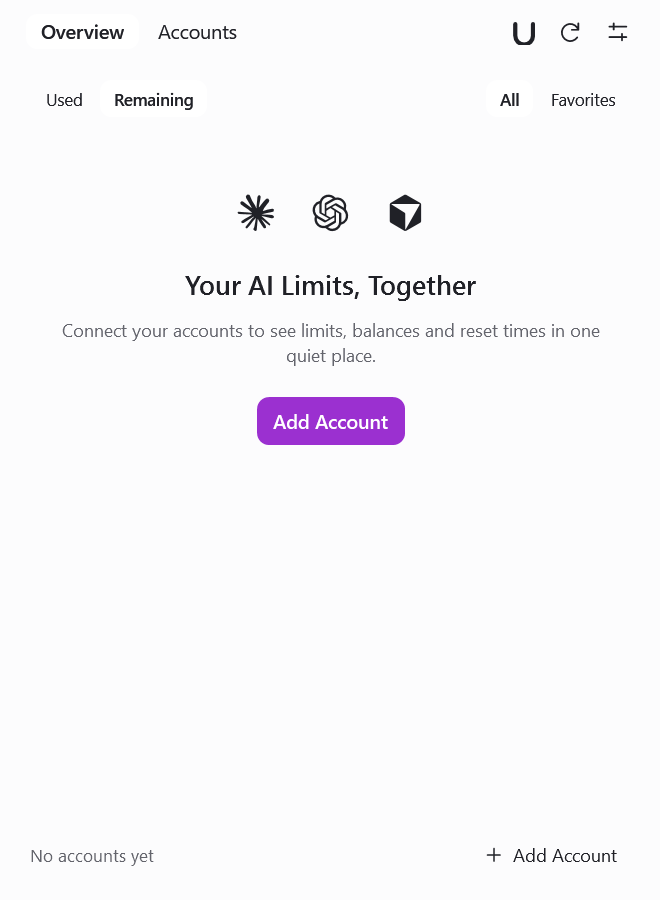

# Windows Product Tour

The Windows edition lives in [`Windows/`](../Windows/) and is independent of the Swift app and the macOS release pipeline. It is a tray app written in C# on .NET 10. The screens are WPF, hosted by the Windows Forms window and tray lifecycle. It supports the same ten providers (Claude, ChatGPT/Codex, Cursor, Antigravity, Copilot, Grok, Ollama, OpenCode, OpenRouter and Z.ai) and follows the same rule as the Mac app: you sign in to each account inside the app, and it never reads credentials or files that belong to other tools.

**Download:** the portable `OpenUsage-windows-x64.exe` (69 MB, no installer, runs without installing .NET) is on the [Windows 0.1.1 release](https://github.com/playertwo1/openusage/releases/tag/windows-v0.1.1). To build it yourself, run `./script/windows.ps1 publish` with the [.NET 10 SDK](https://dotnet.microsoft.com/download/dotnet/10.0). Version history is in [`Windows/CHANGELOG.md`](../Windows/CHANGELOG.md) and details are in [docs/windows.md](windows.md). All screenshots below use made-up demo data, not real accounts.

### Overview

  
  

Overview keeps accounts in saved order, with a separate account heading and two metric lines: **5h** and **Week**. The panel grows or shrinks to fit visible content, capped at the monitor's work area. Overflow scrolls only when the content cannot fit on screen.

Each row shows:

- **The provider and account name**, followed by both available windows with percentages, reset times and bars.
- **Weekly pace warnings** when the projection exceeds the available weekly limit.

Click a row (or press Enter or Space with it focused) to open its **weekly pace chart**. It plots your cumulative weekly use against the ideal line of 14.3% a day, adds a dashed projection to day 7, and marks where the limit would run out. The expanded section also shows "Up to X%/day left" and "Projected N%". Only one row is open at a time. Right-click a row for rename, remove and move actions.

The pace is computed from the provider's own percentage and reset time over a 168-hour window: `expected = elapsed / 168h`, `projection = used / elapsed * 168h`, and the day the limit runs out is when use would reach 100% at the current rate. The chart uses weekly percentages OpenUsage has observed; it does not invent readings for periods when the app was closed. **There is no spend, token or price estimate anywhere**, because the providers do not report those and OpenUsage does not infer them.

The switches above the list choose **Used** or **Remaining** (the displayed values and bars flip) and **All** or **Favorites**.

### Accounts

  

Accounts are grouped by provider, with the provider menu in the group header. Each account is its own list: a header with the name, a plan badge (Pro, Max, Plus and so on) and an account menu, then **one row per metric** with the favorite star, the name, a bar, the value, the reset time and a **Show** switch. "Limit Resets" is a plain row without a bar. Each account ends with its "Updated" time. Here you rename and remove accounts, reorder accounts and providers, star up to two metrics per account for the tray, and hide metrics. Every metric starts shown, and the starred defaults match the Mac app.

### Settings

  

Settings is a short list in three groups.

- **Appearance:** theme (System, Light or Dark), text size (100%, 110% or 125%) and optional soft transparency. Transparency affects the whole panel, without desktop blur, and is disabled in high contrast.
- **Usage Display:** show usage as used or remaining, reset times as a countdown or a date and time, favorites only, and hide account names. Hiding names applies to Overview, the tray, the tray tooltip and notifications. Accounts still shows them so you can manage them.
- **General:** launch at sign-in, low usage alerts (a notification when a limit passes 90%), the global shortcut Ctrl+Alt+U, and the mini widget options below.

### Mini widget

  
  &nbsp;
  
  &nbsp;
  

An optional small panel that floats on your desktop. Turn it on from **Settings > General**, the tray menu ("Show Mini Widget").

- **The pill:** compact provider labels, numbered when a provider has multiple accounts, with a percentage and bar for each available 5h and Week window. Hover to read account details. The mini has no alert dots. A vertical layout is also available. Soft Transparency also applies to this widget.
- **The ball:** click the small collapsed icon to show the mini. Use its minus button or the right-click menu to collapse again. This state is saved; new preferences start in ball mode. Enter or Space also activates the focused ball.
- **Hover over the ball** to open the usage panel directly. Click an account to expand its weekly pace chart inside that panel; click again to collapse it. The ball stays collapsed. The panel remains open while the pointer is over the ball or the panel.
- **Drag it anywhere** by its surface. It snaps while dragging within 32 logical pixels of any work-area edge, leaving a 6-pixel margin. Corners snap on both axes. It remembers its place **per monitor** and moves back into view if your resolution or monitors change.
- **Hover (or click)** to open a flyout with every account's windows, reset times and verdict. It opens on whichever side has room and closes when the mouse leaves.
- **Right-click** for Always on top, Lock position, Vertical layout, Open OpenUsage, Refresh now and Hide widget.
- It has no border, stays out of the taskbar and Alt+Tab, and never takes keyboard focus.

### Adding an account

  
  

**Add Account** opens a provider picker. Claude, ChatGPT, Cursor, Antigravity, Copilot and Grok sign in through your browser or a device code. Ollama, OpenCode, OpenRouter and Z.ai use API keys, and OpenRouter's balance needs a Management key. You can add several accounts per provider. Sign-in tokens are renewed automatically when due, and a failed early renewal keeps a still-valid token and shows an account-specific warning.

### How your data is kept

- Accounts and tokens are saved in `%LOCALAPPDATA%\OpenUsage.Windows\accounts.dat`, encrypted with Windows DPAPI for your user account. Tokens and provider responses are never logged.
- The file also stores your display choices, favorites, hidden metrics and the weekly percentages used for the daily history. Older files without these load with defaults, and your accounts and ordering are preserved.
- If you run the app through a packaged (Microsoft Store) host such as the Codex app, Windows may redirect that folder to a private location. Launch `OpenUsage.exe` directly so it always uses the same file.

### What changed from the first Windows build

The first Windows build worked but looked plain. This edition keeps its sign-ins, ten provider clients and encrypted storage, and changes everything you see:

- A WPF interface modeled on the Mac app, replacing the plain Windows Forms controls, with original provider logos and a compact window you move by its header and resize by its edges.
- Overview, Accounts and Settings rebuilt as described above, with light, dark and system themes and larger text sizes.
- Account headings with two metric lines, expandable weekly charts, and account rings in the hover panel.
- A compact header, AMOLED dark appearance, and distinct session and weekly bars.
- The optional floating mini widget, its flyout, menu and per-monitor position.
- A name privacy option, favorites, per-metric visibility and reordering that now also cover the tray and notifications.
- The portable executable shrank from 173 MB to 69 MB.
- Regression checks for storage, compatibility with older account files, token renewal, usage mapping and the rendered screens, run by `./script/windows.ps1 test`.

Known limits: the window is opaque (no Acrylic or Mica), the shortcuts are fixed, and there is no installer or automatic update.
